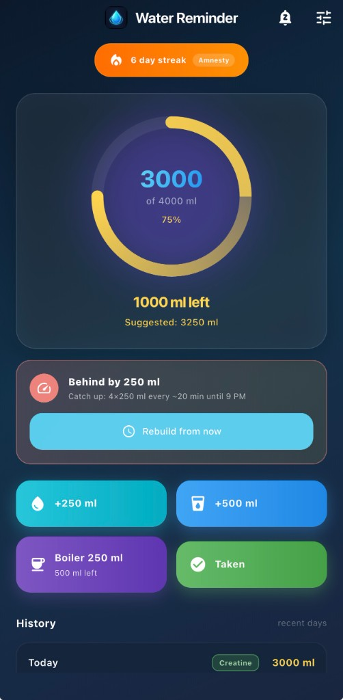
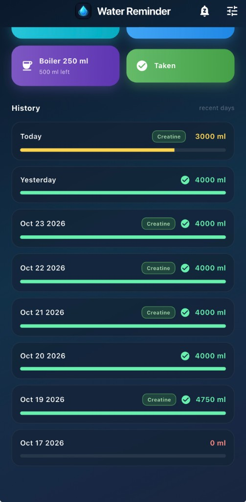
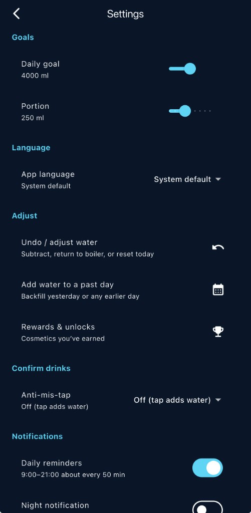

# Water Reminder Flutter

Expanded Flutter port of [WaterReminder](../WaterReminder) (Swift/iOS) — Android, iOS, and macOS.

## Screenshots

<p align="center">
  
  &nbsp;
  
  &nbsp;
  
</p>

| Home | History | Settings |
|:----:|:-------:|:--------:|
| Progress, catch-up, quick actions | Daily log + creatine tags | Goals, language, adjust, rewards |

## Features

| Feature | Description |
|---------|-------------|
| Daily goal | 4000 ml (configurable in Settings) |
| Quick actions | +250 ml, +500 ml, boiler, creatine |
| Boiler | 2000 ml capacity with remaining tracking |
| Streak | Day streak + auto amnesty (1×/month at ≥50% of goal) |
| Creatine | Daily toggle next to the boiler button |
| History | Last 14 days |
| Notifications | 9:00–21:00 about every 50 min |
| **Night 2:00** | Tap to rebuild remaining day into equal 250 ml gaps |
| Quiet slot | Snooze next reminder by 20 minutes |
| Rewards | Cosmetic unlocks (separate screen in Settings) |
| l10n | English & Polish |

## Night notification

At **2:00** a night reminder is sent. On tap:

1. The app opens
2. Remaining water to goal is calculated (goal − drunk)
3. Time until **21:00** is split **evenly** into 250 ml portions
4. The previous schedule is replaced

Example: at 2:00 with 0 ml drunk → 16 × 250 ml spaced ~71 min apart.

In **Settings → Schedule** you can also **Reschedule from now** or **Reset to standard day**.

## Run

```bash
flutter pub get
cd ios && pod install && cd ..   # iOS / macOS only
flutter run
```

## Architecture

```
lib/
├── core/          # constants, theme, locale
├── l10n/          # ARB + generated localizations
├── models/        # WaterDayEntry, BoilerState, RewardsState, …
├── data/          # StorageService (SharedPreferences), WaterRepository
├── services/      # NotificationService, ScheduleCalculator
├── providers/     # Riverpod
├── widgets/       # UI components
└── screens/       # Home, Settings, Rewards
```
